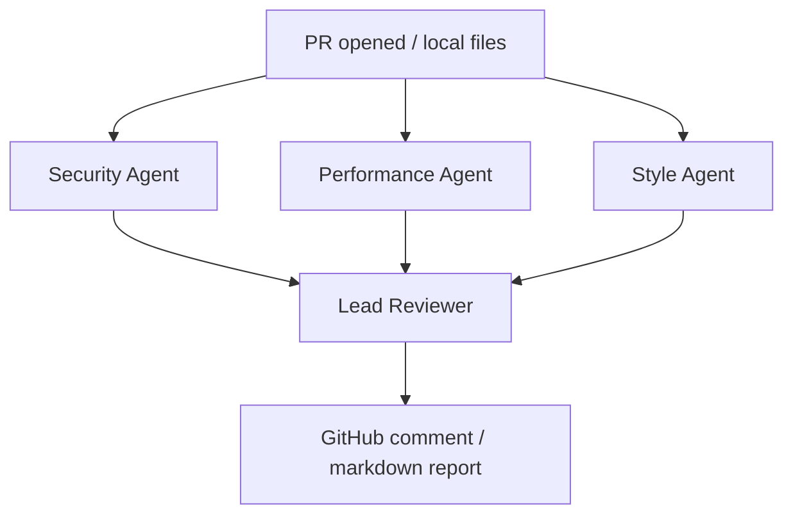

# PR Review Agents

Multi-agent pull-request reviewer: **Security**, **Performance**, and **Style** specialists feed a **Lead Reviewer** that posts one actionable comment.

Works offline with a deterministic analyzer. Optional OpenAI enrichment + GitHub webhook posting.

## Architecture



## Quick start

```bash
python -m venv .venv && source .venv/bin/activate
pip install -r requirements.txt
cp .env.example .env

# Review bundled flawed sample
python cli.py

# Web UI + API
uvicorn app.main:app --reload --port 8001
# http://127.0.0.1:8001
```

## API

- `POST /api/review` — `{ "title": "...", "files": { "path": "content" } }`
- `POST /api/review/sample` — reviews `sample_pr/`
- `POST /webhook/github` — optional GitHub webhook (`pull_request` events)

## GitHub webhook (optional)

1. Deploy the service with a public URL  
2. Create a GitHub webhook → `https://<host>/webhook/github`  
3. Set `GITHUB_WEBHOOK_SECRET` and `GITHUB_TOKEN` (repo scope)

Without tokens, use the CLI / `/api/review` for demos.

## Author

[Vagish Sharma](https://github.com/VagishSharma01) · https://vagish-sharma.vercel.app
